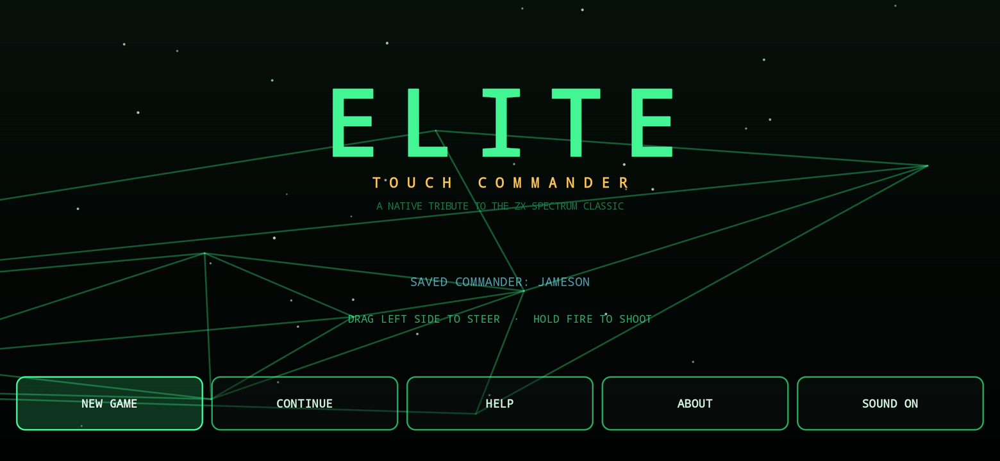

# Elite Touch

A native Android space trading and combat game inspired by **Elite** (Firebird, 1985), designed
from the ground up for touch screens. Wireframe 3D, pirates, docking, trading, hyperspace,
commander ranks, permadeath and synthesized retro sound — in a single small APK, offline,
with no ads and no third-party libraries.

[**Download the APK**](https://github.com/mechaniktso-ctrl/elite-touch/releases/latest) · [Русская инструкция](README.ru.md)



## Features

- **Touch flight** — floating virtual joystick for pitch/yaw, separate fire, missile and
  throttle controls. No keyboard, no mouse, no gamepad required.
- **Wireframe 3D** — station, planet, sun and four pirate ship classes rendered with a custom
  Canvas engine at 60 fps.
- **Combat** — twin pulse lasers with heat build-up, homing missiles, shields, hull damage,
  bounties and an Elite-style rank ladder.
- **Docking and trading** — line up with the station, dock, then buy low and sell high across
  10 commodities. Fuel, missiles and hull repairs are available at the station.
- **28 star systems** — procedural economies, tech levels and governments; a galactic chart
  with distance and fuel costs.
- **Persistence** — auto-save on docking, menu exit and app pause; manual save from the
  station or pause menu. Death deletes the save, as in the original.
- **Synthesized sound** — laser, explosion, missile, docking, hyperspace and UI sounds are
  generated at runtime; no audio files are bundled.
- **Tiny and private** — ~52 KB APK, minSdk 24 (Android 7+), no internet permission.

## Controls

| Control | Action |
|---|---|
| Left side of the screen | Floating joystick: left/right yaw, up/down pitch |
| **FIRE** | Twin lasers (hold; watch the heat bar) |
| **MSL** | Homing missile at the target in your sights (4 max) |
| **THR + / THR −** | Throttle |
| **DOCK** | Dock when the station is within 1.5 km and centred |
| **MENU** | Chart, status, save, sound, quit |
| Android **Back** | Pause / back through screens |

## Quick start

1. Start a new game at **Lave**; the station is straight ahead.
2. Fly forward, then press **DOCK** when it becomes available.
3. On the station: **MARKET** → buy **FOOD**; **CHART** → select **DISO** → **JUMP**;
   dock again and sell the food. That is the classic first trade run.
4. Use the profit for fuel, missiles and hull repairs; hunt pirates for bounty and rank.

## Install

Download the APK from the [latest release](https://github.com/mechaniktso-ctrl/elite-touch/releases/latest) (it is also committed at
[`dist/EliteTouch-1.0.apk`](dist/EliteTouch-1.0.apk)) and open it on an Android device. You may need to allow installation from your browser/file manager. The APK is signed with
a local debug key, which is fine for personal sideloading; configure your own release signing
before publishing on Google Play.

## Build from source

Requirements: JDK 17, Android SDK with platform 35 and build-tools 35.

```sh
git clone https://github.com/mechaniktso-ctrl/elite-touch.git
cd elite-touch
./gradlew assembleRelease
# APK: app/build/outputs/apk/release/app-release.apk
```

The project intentionally has no external dependencies beyond the Android framework: no
AndroidX, no Compose, no game engine. Rendering is a custom `View`/`Canvas` loop, and the
simulation is plain Java.

## Project layout

```
app/src/main/java/com/dsh/elitetouch/
  MainActivity.java   immersive fullscreen activity
  GameView.java       renderer, HUD, touch UI and screens
  Game.java           simulation, combat, trading, save/load
  Galaxy.java         systems, economies, prices
  Models.java         wireframe ship/station models
  Basis.java, Vec3.java  math
  SoundFx.java        runtime WAV synthesis + SoundPool
docs/screenshots/     README images
dist/                 prebuilt APK
```

## Why a remake instead of the original disk?

The project began with a ZX Spectrum disk image labelled
`Elite (1999)(Firebird Software)[m Dimon][GS]`. Its own boot message says:

> ELITE GS 512K ONLY. GENERAL SOUND REMAKE BY DIMON'99

It is a 1999 fan remake that requires **General Sound 512K** hardware. That expansion is not
available on Android and is not supported by ordinary ZX Spectrum emulators, so the disk
cannot boot as-is. This repository therefore contains an original native remake — same kind
of gameplay, written for a touch screen — rather than an emulator or extracted game data.
Nothing from the original disk is redistributed.

This is an unofficial fan project; **Elite** is a trademark of its respective owners.
See [NOTICE.md](NOTICE.md).

## License

MIT — see [LICENSE](LICENSE).
