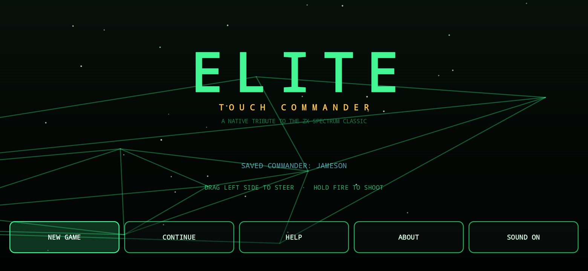

# Elite Touch

Нативная игра для Android в духе **Elite** (Firebird, 1985), сделанная под сенсорный экран:
векторная 3D-графика, пираты, стыковка, торговля, гиперпрыжки, звания, пермасмерть и
синтезированный ретро-звук. Один маленький APK, полностью офлайн, без рекламы и сторонних
библиотек.

[**Скачать APK**](https://github.com/mechaniktso-ctrl/elite-touch/releases/latest) · [English README](README.md)



## Возможности

- **Сенсорное управление** — плавающий джойстик слева (поворот/тангаж), отдельные кнопки
  огня, ракеты и тяги. Клавиатура и геймпад не нужны.
- **Векторный 3D-рендер** — станция, планета, солнце и четыре типа пиратских кораблей
  на собственном Canvas-движке.
- **Бой** — спаренные импульсные лазеры с перегревом, самонаводящиеся ракеты, щиты,
  корпус, награды за пиратов и звания от Harmless до Elite.
- **Стыковка и торговля** — 10 товаров, покупка/продажа, топливо, ракеты и ремонт
  корпуса на станции.
- **28 звёздных систем** — процедурные экономики, технологии и правительства;
  галактическая карта с расстояниями и стоимостью прыжка.
- **Сохранения** — автосохранение при стыковке, выходе в меню и сворачивании; ручное
  сохранение на станции. При гибели сохранение удаляется, как в оригинале.
- **Звук** — лазеры, взрывы, ракеты, стыковка и гиперпрыжок синтезируются на лету;
  аудиофайлов в APK нет.
- **Маленький и приватный** — APK ~52 КБ, minSdk 24 (Android 7+), без разрешения
  на интернет.

## Управление

| Элемент | Действие |
|---|---|
| Левая половина экрана | Плавающий джойстик: влево/вправо — поворот, вверх/вниз — тангаж |
| **FIRE** | Лазеры (держать; следите за полосой нагрева) |
| **MSL** | Ракета по цели в прицеле (максимум 4) |
| **THR + / THR −** | Скорость |
| **DOCK** | Стыковка: станция ближе 1.5 км и в центре обзора |
| **MENU** | Карта, статус, сохранение, звук, выход |
| Кнопка «Назад» | Пауза / назад по экранам |

## С чего начать

1. Новая игра начинается на **Lave**; станция прямо по курсу.
2. Долететь и нажать **DOCK**, когда кнопка станет активной.
3. На станции: **MARKET** → купить **FOOD**; **CHART** → выбрать **DISO** → **JUMP**;
   снова пристыковаться и продать еду. Это классический первый торговый маршрут.
4. Прибыль — на топливо, ракеты и ремонт; за пиратов дают кредиты и звание.

## Установка

Скачайте APK из [последнего релиза](https://github.com/mechaniktso-ctrl/elite-touch/releases/latest) (он же лежит в
[`dist/EliteTouch-1.0.apk`](dist/EliteTouch-1.0.apk)) и откройте файл на телефоне.
Может понадобиться разрешить установку из браузера/файлового менеджера. APK подписан
локальным отладочным ключом — для личной установки этого достаточно; для Google Play
настройте собственный release-ключ.

## Сборка

Нужны JDK 17 и Android SDK с platform 35 и build-tools 35.

```sh
git clone https://github.com/mechaniktso-ctrl/elite-touch.git
cd elite-touch
./gradlew assembleRelease
# APK: app/build/outputs/apk/release/app-release.apk
```

В проекте нет внешних зависимостей, кроме Android framework: ни AndroidX, ни Compose, ни
игрового движка. Рендер — собственный `View`/`Canvas`, симуляция — обычный Java.

## Почему ремейк, а не запуск исходного диска

Проект вырос из образа диска ZX Spectrum
`Elite (1999)(Firebird Software)[m Dimon][GS]`. Внутри написано:

> ELITE GS 512K ONLY. GENERAL SOUND REMAKE BY DIMON'99

Это ремейк 1999 года, которому нужна плата **General Sound 512K**. На Android её нет, и
обычные ZX-эмуляторы её не поддерживают, поэтому диск не запускается «как есть». Здесь
лежит самостоятельная нативная игра с похожей механикой, а не эмулятор и не извлечённые
данные. Ничего из исходного диска в репозитории нет.

**Elite** — торговая марка соответствующих правообладателей; это неофициальный
некоммерческий фан-проект. Подробности — в [NOTICE.md](NOTICE.md).

## Лицензия

MIT — см. [LICENSE](LICENSE).
